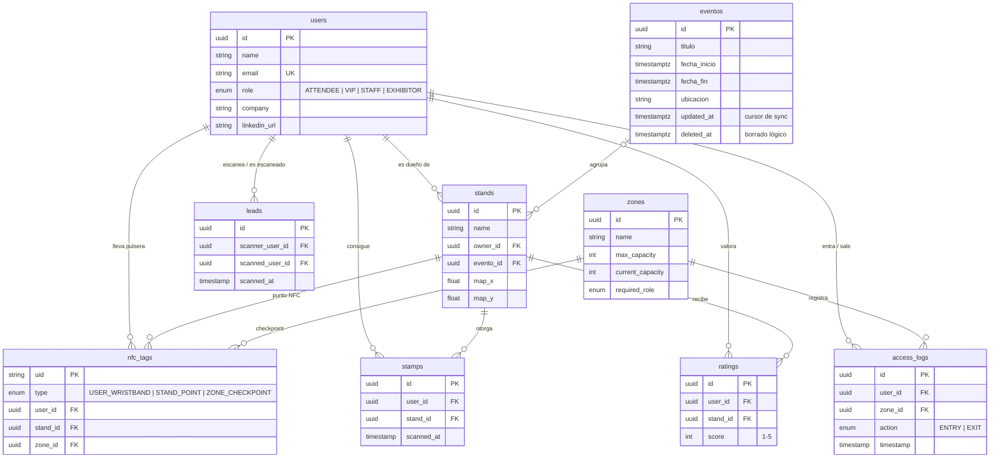

# Your Way

Plataforma de gestión de eventos y festivales basada en **pulseras NFC** y diseñada para funcionar **sin conexión (offline-first)**. Proyecto de la asignatura ISM.

## ¿Qué hace?

La pulsera NFC es el identificador único de cada asistente. A partir de ella el sistema ofrece:

- **Acreditación y vinculación NFC:** el organizador vincula a cada invitado con una pulsera en la entrada.
- **Intercambio de contactos (lead retrieval):** escanear la pulsera de otra persona guarda su contacto al instante.
- **Gamificación ("Passport to Prizes"):** puntos NFC en los estands otorgan sellos; acumular suficientes desbloquea recompensas.
- **Control de acceso y aforo:** zonas restringidas por rol (VIP, Staff…) y ocupación por sala en tiempo real.
- **Feedback de estands:** valoración de 1 a 5 estrellas y ranking público.
- **Mapa, aforo y notificaciones:** plano 2D interactivo con semáforo de ocupación y avisos de la organización.
- **Dashboard del organizador:** estadísticas locales (usuarios por rol, sellos y valoraciones por estand, leads, ocupación por zona).

Todas las lecturas y cambios se guardan primero en SQLite local y se sincronizan con **Supabase** cuando hay conexión.

### Estado actual

| Funcionalidad | Estado |
|---|---|
| Base local SQLite (esquema, datos de ejemplo) | ✅ |
| Dashboard del organizador y creación de eventos | ✅ |
| Sincronización de `eventos` con Supabase (Spec 07) | ✅ |
| Plano 2D, aforo por zona con semáforo, alertas y gestión de estands STAFF (Spec 03) | ✅ |
| Sincronización de plano, estands y logs de aforo con Supabase | ✅ |
| Lectura NFC, leads B2B y control de accesos (Spec 05) | 🔵 Pendiente (solo `domain/b2b/accessValidator.ts`) |

## Stack

| Capa | Tecnología |
|---|---|
| App móvil | React Native 0.88, Expo 58, Expo Router, TypeScript estricto |
| Navegación | Expo Router (pestañas *Resumen* y *Mapa*) |
| Almacenamiento local | SQLite (`expo-sqlite`, BD `your-way-v2.db`) |
| Backend | Supabase (PostgreSQL + RLS, sesión anónima) vía `@supabase/supabase-js` |
| Conectividad | `expo-network` (resincroniza al recuperar conexión) |
| Mapa | `react-native-svg` |
| Notificaciones | `expo-notifications` |
| NFC (previsto) | `react-native-nfc-manager` — aún no instalado |

## Estructura del repositorio

```
your-way/
├── app-eventos/        # App móvil (Expo)
│   ├── src/app/        # Rutas (Expo Router): `index` (Resumen) y `mapa`
│   ├── src/screens/    # Pantallas: dashboard del organizador, crear evento, mapa
│   ├── src/components/ # Componentes de UI (plano SVG, centro de notificaciones…)
│   ├── src/hooks/      # Hooks que conectan UI y persistencia
│   ├── src/domain/     # Lógica de negocio sin React Native (mapa/aforo, alertas, sync, b2b)
│   ├── src/database/   # Esquema SQLite y repositorios
│   ├── src/sync/       # Adaptadores de sincronización con Supabase
│   ├── src/lib/        # Cliente Supabase
│   ├── src/providers/  # SyncProvider y NotificationProvider
│   └── tests/          # Tests del dominio (node:test)
├── supabase/migrations/ # Migraciones SQL de Supabase
├── specs/              # Especificaciones (Spec 01, 03, 05, 07)
├── spec.md             # Especificación general del sistema
├── plan.md             # Hoja de ruta por fases
├── tasks.md            # Product backlog de la Fase 1
├── constitution.md     # Reglas, stack y acuerdos del equipo
├── schema.sql          # Esquema PostgreSQL base del backend
├── .github/skills/     # Skills de Spec Kit / Copilot
└── .specify/           # Plantillas y scripts de Spec Kit
```

## Arquitectura

Arquitectura hexagonal con DDD: la lógica de negocio (`src/domain`) no depende de React Native; la UI y los hooks de persistencia están separados siguiendo un patrón Presenter/MVC. Cada cambio local se marca `pending` y se sube a Supabase en la siguiente sincronización; la bajada es incremental por `updated_at` (fijado por el servidor). Un fallo de red nunca bloquea la app: los datos quedan pendientes y se reintentan al volver la conexión.

## Base de datos

Vista rápida del modelo (mismo modelo en SQLite local y en Supabase; esquema completo en [`schema.sql`](schema.sql)):



Solo en local (SQLite) existen además: `sync_status` en `eventos` y `stands` (cola de subida), `local_sync_state` (cursores de bajada), `local_map_metadata` y `cached_notifications`.

## Puesta en marcha

Requisitos: Node.js y npm; Expo Go o un emulador Android/iOS; un proyecto Supabase.

1. Aplica en Supabase `schema.sql` y después las migraciones de `supabase/migrations/`, y habilita el inicio de sesión anónimo.
2. Configura las credenciales:

```bash
cd app-eventos
cp .env.example .env.local   # rellena EXPO_PUBLIC_SUPABASE_URL y EXPO_PUBLIC_SUPABASE_KEY
npm install
npm start          # Expo dev server
npm run android    # o: npm run ios / npm run web
```

Otros comandos:

```bash
npm run lint         # ESLint (expo lint)
npm run test:domain  # tests de la lógica de dominio
npx tsc --noEmit     # comprobación de tipos
```

> La lectura NFC requiere un dispositivo físico con NFC; no funciona en emuladores ni en web.

## Hoja de ruta

1. **Arquitectura base y entorno:** repo, CI/CD, app multiplataforma, modelo de dominio, base local.
2. **Core NFC y gestión local:** lectura/escritura NFC, vinculación de pulseras, intercambio de contactos.
3. **Gamificación y aforo:** sellos, permisos por zona, cálculo de aforo.
4. **Sincronización y analíticas:** servidor central, cola de sincronización, dashboard, notificaciones en tiempo real.

Detalle en [`plan.md`](plan.md), [`tasks.md`](tasks.md) y [`specs/`](specs/).

## Metodología y contribución

- **Scrum**, sprints de 1 semana, tareas en GitHub Projects vinculado a las issues.
- **Feature branching:** `feature/TASK-XX-breve-descripcion`; los cambios a `main` entran por Pull Request.
- TypeScript con `strict: true`, sin `any`.

Reglas completas en [`constitution.md`](constitution.md).
